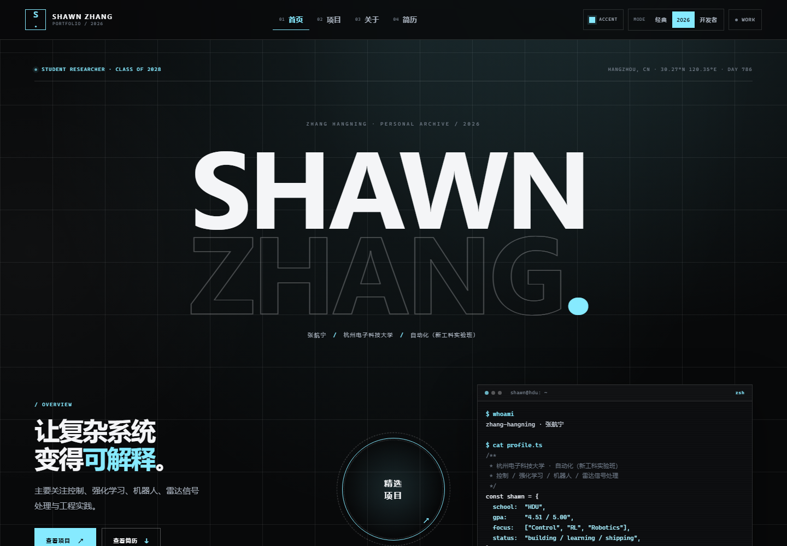
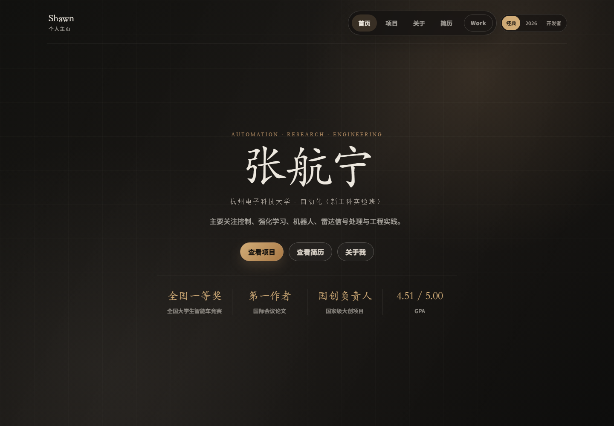
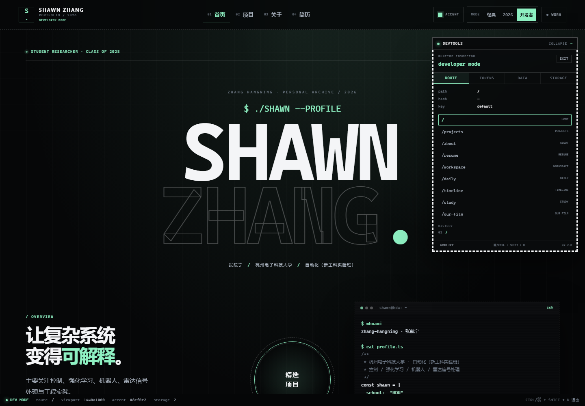
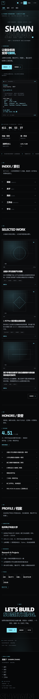

# 2026 Redesign · 使用说明

本次改版以 [Payathon 2026](https://aipay.alipay.com/community/events/payathon-2026) 的视觉语言为参照：近黑画布、霓虹强调色、超大字标、等宽字体标签、终端窗口、倒计时与编号章节。

原始站点没有被改写。新版全部走一层独立 skin：`classic` 保持原有样式，`payathon` 与新 `dev` 皮肤的所有规则都限定在 `html[data-skin="payathon"]` / `html[data-skin="dev"]` 下。



## 三种模式

| 模式 | 说明 | 状态 |
| --- | --- | --- |
| 经典 `classic` | 原始的个人主页 / 项目 / 简历 / 博客 / Work / 私人电影，仅头部多出模式开关 | 保留 |
| 2026 `payathon` | 全新首页与全站暗色科技风，默认模式 | 新增 |
| 开发者 `dev` | 在 2026 视觉上追加 runtime inspector、状态栏、12 列网格与快捷键 | 新增 |

### 切换方式

- 头部右上角的 `经典 / 2026 / 开发者` 分段开关，切换后写入 `localStorage`。
- 快捷键 `Ctrl / ⌘ + Shift + D` 在 `2026` 与 `开发者` 之间切换。
- URL 强制预览：`?skin=classic`、`?skin=payathon`、`?skin=dev`（哈希路由下加在 `#` 之前）。
- 2026 / 开发者模式下可以点 `ACCENT` 切换 12 种强调色，选择同样会被记住。

> 首次访问默认进入 2026 模式；想回到原版，点「经典」即可，页面结构、数据与交互均保持原样。



## 开发者模式



开发者模式是一个真正可用的小型运行时面板，而不只是换色：

- **ROUTE**：当前路径、hash、location key、路由跳转、最近 8 条访问历史。
- **TOKENS**：实时读取 CSS 变量、视口尺寸、DPR、动效偏好、12 种强调色。
- **DATA**：当前站点的 profile / projects / posts / honors 结构化 JSON，可一键复制。
- **STORAGE**：列出全部 `localStorage` 键值，可展开查看、复制、单独删除或清空。
- **GRID**：`Ctrl / ⌘ + Shift + G` 或面板内按钮打开 12 列开发网格。
- 底部固定状态栏显示当前路由、视口、强调色与存储条目数量。

面板可折叠；移动端默认收起，避免遮挡内容。

## 首页组成

- 超大字标 `SHAWN / ZHANG.` 与中文名、学校、专业信息。
- `$ cat profile.ts` 终端，逐行揭示个人档案。
- 可交互的圆形「精选项目」入口。
- 距 2028.06 毕业的实时倒计时、亮点数据、持续滚动的技术栈跑马灯。
- `INDEX` 索引、`SELECTED WORK` 项目卡、`HONORS` 荣誉、`PROFILE` 档案与收尾 CTA。



## 文件结构

新增：

```
src/redesign/
  skin.tsx        模式 / 强调色 / 持久化 / 开关组件
  chrome.tsx      2026 头部与页脚
  home.tsx        2026 首页、终端、倒计时
  devtools.tsx    开发者面板、状态栏、网格
  redesign.css    全部新皮肤样式（作用域隔离）
docs/REDESIGN.md
docs/redesign/*.png
```

改动：

- `src/main.tsx`：接入 SkinProvider、条件渲染新版头尾/首页、接入开发者面板；经典头部只是多了一个模式开关。
- `index.html`：首屏前读取 `localStorage` 设置 `data-skin` 与强调色，避免闪烁；补充内联 favicon。
- `src/redesign/redesign.css`：全部样式限定在新皮肤，不覆盖 `classic`。

未改动：

- `src/styles.css`、`src/project-management.css` 原样保留。
- 全部路由、Markdown 数据、Work 模式、评论 / 学习进度 / 项目管理逻辑保持原实现。
- `/our-film` 私人电影页仍走 `MemoryPage`，不受新皮肤影响。

## 验证

```bash
npm run build   # TypeScript + Vite 生产构建
npm run dev     # 本地预览
```

已验证：桌面 1920 / 1440 / 1024、平板 768、移动 390 布局；三种模式切换与刷新持久化；开发者面板四个标签、网格、复制与存储操作；`prefers-reduced-motion` 下终端直接显示全文、跑马灯与旋转动画停止。
